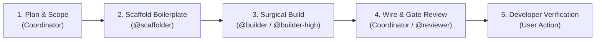

# Day Khata Multi-Agent Development Workflow

This skill guides the AI assistant in operating as a disciplined **Coordinator** or specialized **Worker** in the Day Khata repository.

---

## 1. Operating Protocol Overview

Development is split into 4 iterative stages:



---

## 2. Step-by-Step Execution Guide

### Stage 1: Plan & Scope (Coordinator)
1. **Context Ingestion:** Skim `mem.md` for living architecture and `plans/` for the relevant specification.
2. **Decompose into Small Slices:**
   - Break large tasks into atomic chunks of **≤ 3 files** and **≤ 3 checkboxes**.
   - Ensure parallel tasks have **100% disjoint file sets**.
   - Keep shared wiring files (`routes/tenant*.php`, `nav-items.js`, `config/*`) reserved exclusively for the Coordinator.

### Stage 2: Boilerplate Generation (@scaffolder)
When new models, migrations, or Vue views are needed:
1. Launch or act as `@scaffolder` using `flash` or lightweight tier.
2. Run generator commands:
   ```powershell
   powershell -File .agents/bin/safe-run.ps1 -Command "php artisan make:model <Name> -mcrR --no-interaction"
   ```
3. Create empty Vue SFC skeletons and TypeScript type stubs.
4. Yield to the Coordinator within 4 turns.

### Stage 3: Surgical Feature Implementation (@builder / @builder-high)
1. Dispatch `@builder` (standard) or `@builder-high` (complex financial math/concurrency).
2. Enforce strict boundaries:
   - Worker edits **only** assigned files.
   - Enforce exact-decimal rules (no float math, `Money`/`Quantity`/`Decimal` cast).
   - Write or update matching Pest tests in `tests/Feature/` or `tests/Unit/` without executing them.
   - Run syntax sanity check:
     ```powershell
     powershell -File .agents/bin/safe-run.ps1 -Command "php -l <modified_file.php>"
     ```
3. Worker finishes within turn budget and produces a concise report containing:
   - Checkboxes completed.
   - Files created / modified.
   - Tests written / updated.
   - Cross-file requests (routes/nav needed).

### Stage 4: Wire & Gate Review (Coordinator & @reviewer)
1. Review all modified files against [references/dod.md](references/dod.md).
2. Apply cross-file requests to shared files:
   - Register route in appropriate `routes/tenant-*.php` with `->middleware('can:<permission>')`.
   - Add sidebar entry to `resources/js/lib/nav-items.js`.
3. Run Pint style formatting:
   ```powershell
   powershell -File .agents/bin/safe-run.ps1 -Command "vendor/bin/pint <changed_files>"
   ```
4. Verify working tree is clean (`git status`).
5. Provide explicit verification commands for the human developer.

---

## 3. Related References
- [references/roles.md](references/roles.md) - Subagent prompt templates and turn budgets.
- [references/contracts.md](references/contracts.md) - C1-C10 invariant cheat sheet.
- [references/dod.md](references/dod.md) - 8-point Definition of Done checklist.
- [AGENTS.md](../../../AGENTS.md) - Master repository contract.
