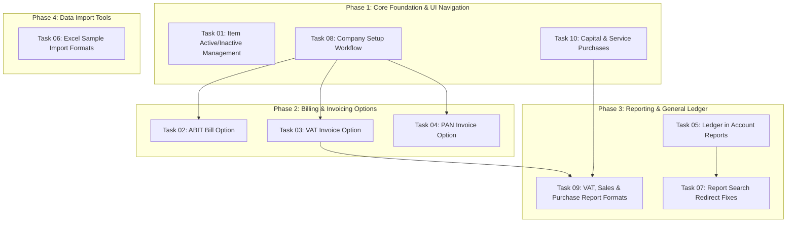

# Master Implementation Checklist: 10 Client Requirements

This checklist tracks the implementation, dependencies, and verification for the 10 client requirements migrated from legacy `day_khata` into the new multi-tenant Laravel application.

> [!NOTE]
> **Implementation Complete across All 10 Tasks.**
> Code, tests, and the Browser QA Verification Guide in `verify.md` are fully prepared and synchronized. All 10 client requirements have been implemented according to their respective plans.

---

## Task Overview & Implementation Order

---

## Detailed Checklist & Tasks

| # | Requirement | Status | Detailed Plan | Dependencies | Verification Command |
|---|---|---|---|---|---|
| **01** | Replace Item Deletion with Active/Inactive Management | `Completed` | [plans/01-item-active-inactive.md](plans/01-item-active-inactive.md) | None | `tests/Feature/Tenant/Inventory/ItemStatusManagementTest.php` |
| **02** | Restore the ABIT Bill Option | `Completed` | [plans/02-abit-bill-option.md](plans/02-abit-bill-option.md) | Task 08 | `php artisan test tests/Feature/Tenant/Sales/BillingInvoiceTypesTest.php` |
| **03** | Restore the VAT Invoice Option | `Completed` | [plans/03-vat-invoice-option.md](plans/03-vat-invoice-option.md) | Task 08 | `php artisan test tests/Feature/Tenant/Sales/BillingInvoiceTypesTest.php` |
| **04** | Restore the PAN Invoice Option | `Completed` | [plans/04-pan-invoice-option.md](plans/04-pan-invoice-option.md) | Task 08 | `php artisan test tests/Feature/Tenant/Sales/BillingInvoiceTypesTest.php` |
| **05** | Add Ledger Viewing to Account Reports | `Completed` | [plans/05-account-report-ledger.md](plans/05-account-report-ledger.md) | None | `php artisan test tests/Feature/Tenant/Reports/AccountReportLedgerTest.php` |
| **06** | Excel Sample Formats for All Import Features | `Completed` | [plans/06-excel-import-sample-formats.md](plans/06-excel-import-sample-formats.md) | None | `php artisan test tests/Feature/Tenant/Imports/ExcelSampleFormatsTest.php` |
| **07** | Fix Report Search Redirecting to Dashboard | `Completed` | [plans/07-report-search-fixes.md](plans/07-report-search-fixes.md) | Task 05 | `php artisan test tests/Feature/Tenant/Reports/VatSalesPurchaseReportFormatsTest.php` |
| **08** | Restore Company Setup Workflow | `Completed` | [plans/08-company-setup-workflow.md](plans/08-company-setup-workflow.md) | None | `php artisan test tests/Feature/Tenant/Admin/CompanySettingTest.php` |
| **09** | Correct VAT, Sales, and Purchase Report Formats | `Completed` | [plans/09-vat-sales-purchase-report-formats.md](plans/09-vat-sales-purchase-report-formats.md) | Tasks 02, 03, 10 | `php artisan test tests/Feature/Tenant/Reports/VatSalesPurchaseReportFormatsTest.php` |
| **10** | Restore Capital & Service Option in Purchase | `Completed` | [plans/10-capital-service-purchase-option.md](plans/10-capital-service-purchase-option.md) | None | `php artisan test tests/Feature/Tenant/Purchases/CapitalPurchaseTest.php` |

---

## Detailed Task Breakdown

### [Task 01: Replace Item Deletion with Active/Inactive Management](plans/01-item-active-inactive.md)
- [x] Add `PATCH /items/{item}/toggle-active` endpoint to `routes/tenant-business.php`.
- [x] Implement `ItemController::toggleActive()` with zero-stock assertion (`$item->currentStock()->isZero()`).
- [x] Update `Items/Index.vue` with **Active Items** and **Inactive Items** tabs.
- [x] Replace `Delete` action in `RowActions` with `Mark Inactive` (with confirmation modal and stock check).
- [x] In the Inactive tab, add `Reactivate` action button.
- [x] Verify transactions, stock movements, and historical reports remain intact.

### [Task 02: Restore the ABIT Bill Option](plans/02-abit-bill-option.md)
- [x] Add `invoice_type` selection in `Sales/Create.vue` with `ABIT Bill (Abbreviated)`.
- [x] Activate `[ABIT]` button toggle in `PosTopBar.vue` and `Pos.vue`.
- [x] Enforce statutory NPR 10,000 ceiling (`assertAbbreviatedCeiling()`) in both frontend and backend.
- [x] Ensure billing allocates `VoucherType::SaleAbbreviated` and sequence prefix `sale_abbreviated_prefix`.
- [x] Verify print output renders IRD Abbreviated Tax Invoice (`resources/views/pdf/ird/abbreviated.blade.php`).

### [Task 03: Restore the VAT Invoice Option](plans/03-vat-invoice-option.md)
- [x] Add `VAT Invoice (Full Tax)` option in `Sales/Create.vue`.
- [x] Activate `[TAX]` button toggle in `PosTopBar.vue` and `Pos.vue`.
- [x] Enforce customer name and 9-digit PAN validation for transactions above NPR 10,000.
- [x] Ensure billing allocates `VoucherType::Sale` and sequence prefix `sale_full_prefix`.
- [x] Post 13% Output VAT to `LIA20` (Output VAT).
- [x] Verify print output renders IRD Full Tax Invoice (`resources/views/pdf/ird/tax.blade.php`).

### [Task 04: Restore the PAN Invoice Option](plans/04-pan-invoice-option.md)
- [x] Add `PAN Invoice` option in `Sales/Create.vue`.
- [x] Activate `[PAN]` button in `PosTopBar.vue` for PAN-configured shops.
- [x] Enforce 0.00% VAT across all items and hide tax breakdown rows in summary bar.
- [x] Ensure billing allocates `VoucherType::SalePan` and sequence prefix `sale_pan_prefix`.
- [x] Verify print output renders IRD PAN Bill (`resources/views/pdf/ird/pan.blade.php`).

### [Task 05: Add Ledger Viewing to Account Reports](plans/05-account-report-ledger.md)
- [x] Register `/reports/ledger`, `/reports/ledger/print`, and `/reports/ledger/export` in `routes/tenant-reports-accounting.php`.
- [x] Add `AccountingReportController::ledger()` reusing `accountBook()` calculations.
- [x] Create `resources/js/pages/Tenant/Reports/Ledger.vue` with Account Combobox and Nepali date pickers.
- [x] Add "Ledger" link as the first item under `Account Reports` in `resources/js/lib/nav-items.js`.
- [x] Support Print and Excel export.

### [Task 06: Excel Sample Formats for All Import Features](plans/06-excel-import-sample-formats.md)
- [x] Create `CustomerSampleExport.php` and endpoint `GET /customers/import/sample-excel`.
- [x] Create `SupplierSampleExport.php` and endpoint `GET /suppliers/import/sample-excel`.
- [x] Create `ItemSampleExport.php` and endpoint `GET /items/import/sample-excel`.
- [x] Create `OpeningStockSampleExport.php` and endpoint `GET /stock-adjustments/opening-stock/sample-excel`.
- [x] Create `OpeningBalanceSampleExport.php` and endpoint `GET /accounts/opening-balances/sample-excel`.
- [x] Add "Download Sample Excel (.xlsx)" and "Download CSV template" buttons to all import modals.

### [Task 07: Fix Report Search Redirecting to Dashboard](plans/07-report-search-fixes.md)
- [x] In `AppLayout.vue`, fix `selectActiveCommand()` so hitting Enter on a non-matching query NEVER redirects to `/dashboard`.
- [x] Update placeholder to `"Navigate pages and actions (Ctrl K)"`.
- [x] Add in-page text search inputs on report pages (Sales Register, Purchase Register, Day Book, Cash Book, Bank Book, Ledger) to search by invoice/bill number, voucher number, or party name.
- [x] Update controllers to filter by search term in place without page reloads.

### [Task 08: Restore Company Setup Workflow](plans/08-company-setup-workflow.md)
- [x] Create `routes/tenant-settings.php` for `GET /settings`, `PUT /settings`, `POST /settings/logo`, `DELETE /settings/logo`.
- [x] Implement `CompanySettingController` to view and update `CompanySetting::current()`.
- [x] Create `resources/js/pages/Tenant/Admin/Settings/Edit.vue` with Profile, Logo, Invoicing, and Bill Customization tabs.
- [x] Add "Company Setup" under `ADMIN` in `resources/js/lib/nav-items.js` and in the user avatar dropdown menu.

### [Task 09: Correct VAT, Sales, and Purchase Report Formats](plans/09-vat-sales-purchase-report-formats.md)
- [x] Update `SalesPurchaseReportController.php` to compute `subtotal = taxable_amount + nontaxable_amount` for all rows and in `totalsFor()`.
- [x] Rearrange table columns in all 6 Vue registers (`SalesRegister`, `PurchaseRegister`, `SalesVatBook`, `PurchaseVatBook`, `SalesReturnRegister`, `PurchaseReturnRegister`) to:
  `Sub Total` -> `Non-Taxable` -> `Taxable` -> `VAT` -> `Total`.
- [x] Update summary footer cards to display Sub Total in sequence.
- [x] Fix label on `SalesVatBook.vue` line 116 to `"Capital sales amount"`.
- [x] Update Excel export headings in all 5 export classes.

### [Task 10: Restore Capital & Service Option in Purchase](plans/10-capital-service-purchase-option.md)
- [x] In `resources/js/lib/nav-items.js:102`, rename link to `"Capital & Service"` (maintaining `/capital-purchases`).
- [x] Update PageHeader titles and buttons in `CapitalPurchases/Index.vue` and `Create.vue`.
- [x] Add a Type filter (`All`, `Capital`, `Service`) on `CapitalPurchases/Index.vue`.
- [x] In `SalesPurchaseReportController::capitalPurchaseVatRow()`, set `'capital_amount'` and `'capital = true'` ONLY when `purchase->type === 'capital'`, correctly reporting `service` purchases as operational taxable purchases.

---

## Rules of Engagement During Implementation
1. **Approval Gate**: Do not begin modifying application code until explicit user approval is provided.
2. **One Task at a Time**: Implement one task, verify via tests and UI, update this checklist, and request sign-off before proceeding.
3. **Multi-Tenant Scoping**: All database operations must remain strictly scoped to the active tenant (`tenant()->id`).
4. **Zero Regressions**: Existing test suites must continue passing after each task.
